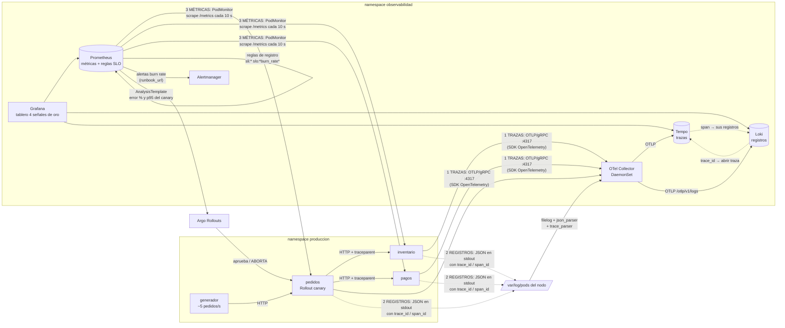

# Flujo de la telemetría: del servicio al tablero y a la alerta

## Recorrido de una petición

1. El generador hace `POST /pedidos`.
   - El SDK de OpenTelemetry de **pedidos** crea la traza (`trace_id`).
   - En cada llamada a inventario y a pagos, la propagación W3C inyecta la cabecera `traceparent`. Es explícita en el código: `opentelemetry.propagate.inject()` en `servicios/telemetria.py`.
   - Inventario y pagos **continúan la misma traza**, así que una sola compra queda como una traza de unos 9 spans en 3 servicios.
2. Cada servicio escribe **una línea JSON por evento** con `trace_id` y `span_id` de la traza activa.
   El Collector la lee del nodo, la convierte a OTLP y la envía a Loki.
   - `service_name`, `k8s_pod_name` y `k8s_namespace_name` quedan como etiquetas.
   - `level`, `trace_id`, `pedido_id`, `status` y `duration_ms` quedan como metadatos consultables por campo.
3. Prometheus recolecta `/metrics` de cada pod:
   - **Técnicas:** `http_server_requests_seconds` (histograma de latencia, tráfico y errores por estado) y `http_server_requests_in_flight` (saturación).
   - **De negocio:** `pedidos_creados_total`, `pedidos_rechazados_total{motivo}`, `pagos_rechazados_total{motivo}`, `inventario_sin_stock_total` e `ingresos_quetzales_total`.
   - El PodMonitor copia la etiqueta `rollouts_pod_template_hash`, así cada serie sabe si viene del canary o de la versión estable.
4. **Decisión automática:** Argo Rollouts evalúa el AnalysisTemplate contra Prometheus, solo sobre el hash del canary, y promueve o aborta.
5. **Decisión humana:** las reglas convierten las métricas en SLI y burn rate.
   - La alerta multiventana llega a Alertmanager con un `runbook_url`.
   - El operador sigue el recorrido Grafana → traza (Tempo) → registro (Loki).
